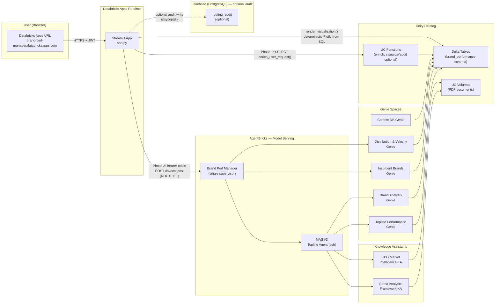
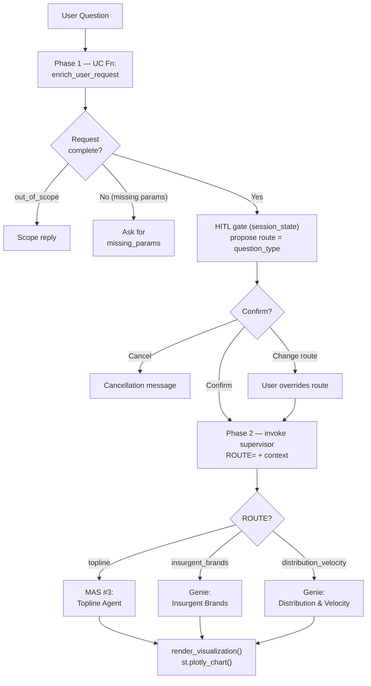
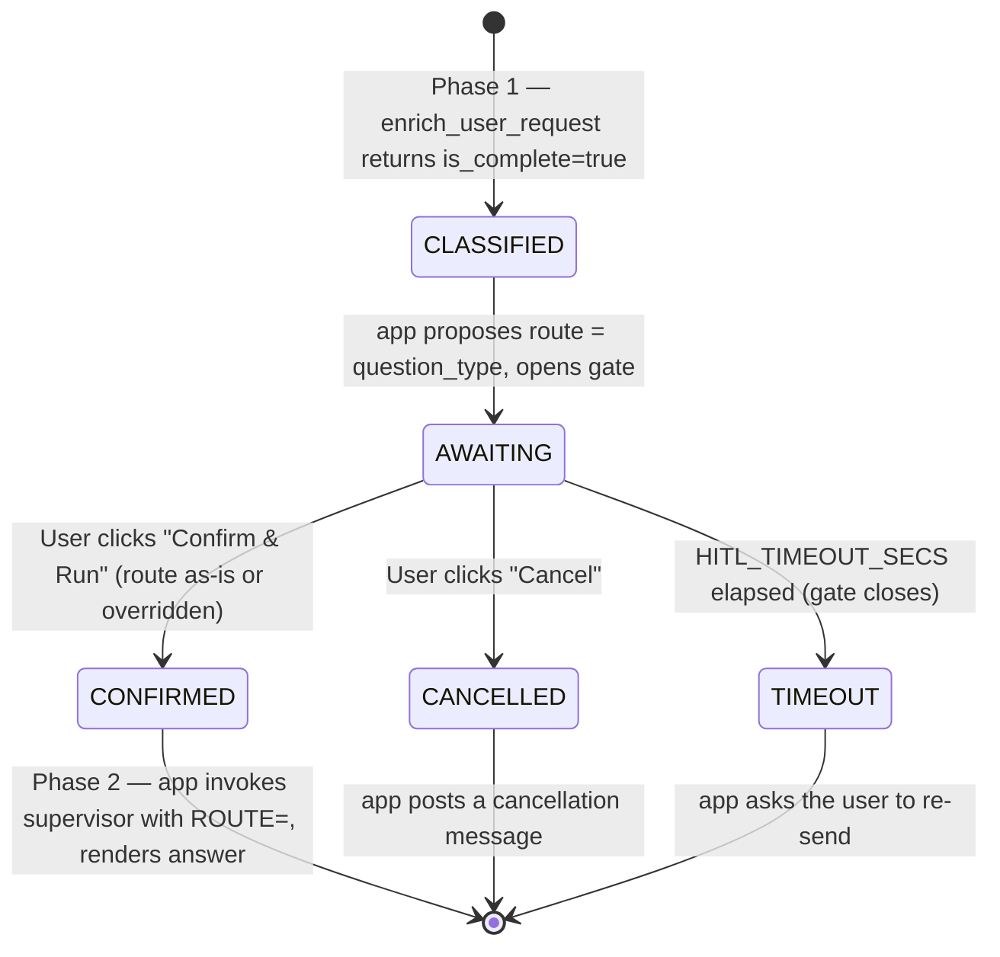
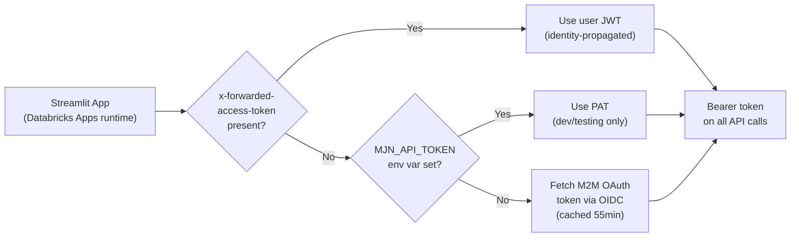
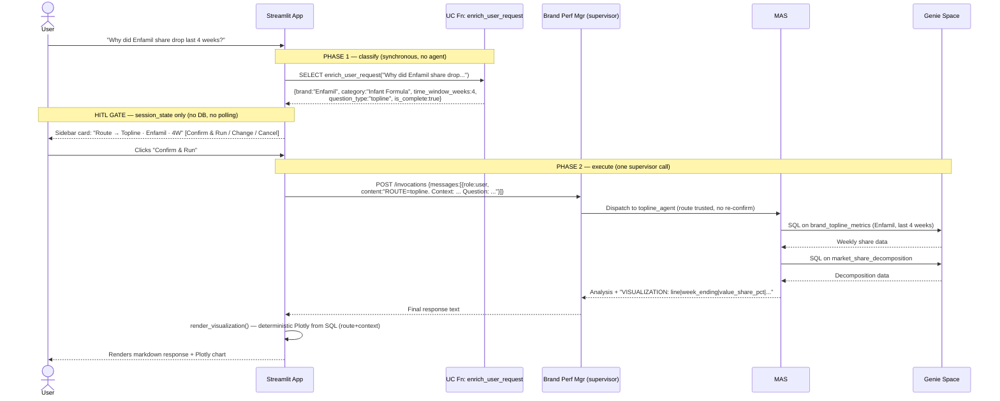
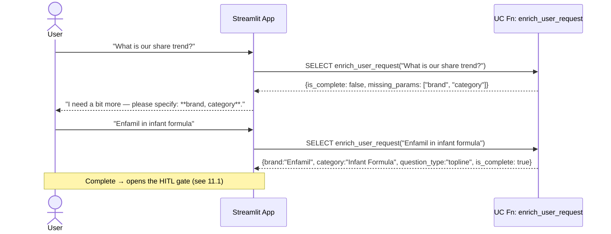
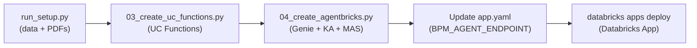

# Software Design Document
# Brand Performance Manager — Multi-Agent AI Application

**Version:** 1.0  
**Status:** Draft  
**Date:** May 2026  
**Platform:** Databricks (AgentBricks, Genie, Databricks Apps, Lakebase, Unity Catalog)  
**Related Document:** [PRD.md](PRD.md)  
**Confidential: For internal use**

---

## Table of Contents

1. [System Context](#1-system-context)
2. [Component Architecture](#2-component-architecture)
3. [Agent Design](#3-agent-design)
4. [Data Layer Design](#4-data-layer-design)
5. [Unity Catalog Function Design](#5-unity-catalog-function-design)
6. [Visualization Adapter Design](#6-visualization-adapter-design)
7. [HITL Mechanism Design](#7-hitl-mechanism-design)
8. [Streamlit Application Design](#8-streamlit-application-design)
9. [Authentication & Authorization Design](#9-authentication--authorization-design)
10. [API Contracts](#10-api-contracts)
11. [Sequence Diagrams](#11-sequence-diagrams)
12. [Error Handling Strategy](#12-error-handling-strategy)
13. [Performance & Caching Design](#13-performance--caching-design)
14. [Deployment Design](#14-deployment-design)
15. [Testing Strategy](#15-testing-strategy)

---

## 1. System Context

### 1.1 Landscape Diagram



### 1.2 Deployment Boundaries

| Component | Deployment Location | Managed By |
|---|---|---|
| Streamlit frontend | Databricks Apps | DAB bundle (`databricks.yml`) |
| Brand Performance Manager + MAS #3 (2 MAS) | AgentBricks (Model Serving) | `manage_mas` MCP tool |
| Genie Spaces (5x) | Databricks AI/BI | `manage_genie` MCP tool |
| Knowledge Assistants (2x) | AgentBricks | `manage_ka` MCP tool |
| Visualization | App-side (deterministic Plotly) | `app.py` |
| Delta Tables (5x) | Unity Catalog | `01_generate_brand_data.py` |
| UC Functions (1 required + 2 optional) | Unity Catalog | `03_create_uc_functions.py` |
| PDF Documents | Unity Catalog Volume | `02_generate_brand_docs.py` |
| Routing audit table (optional) | Lakebase (PostgreSQL) | `run_setup.py` |

### 1.3 Divergences from the reference architecture (technical)

This design realises the reference architecture's behaviour but deviates from its
structure in four intentional ways. See PRD §5.1 for the product-level rationale and the
full mapping table; the technical drivers are:

1. **Intake / Router are not supervisor agents.** The reference draws both as MAS boxes.
   Intake is a deterministic extraction → a direct `enrich_user_request` UC-function call
   from the app (Phase 1). Routing is the app-owned HITL gate. This removes two LLM
   supervisor hops from every request.
2. **In-agent HITL is not buildable on AgentBricks.** A deployed MAS endpoint is a
   **synchronous request/response** invocation (ChatAgent / Responses API). It cannot
   suspend execution, persist intermediate state, and resume on an external signal minutes
   later. Therefore the diagram's "HITL human confirmation *inside* the Router/Intake
   agent" is realised as an **app-orchestrated gate between two separate calls** (classify
   → gate → execute). This is the central reason the HITL cannot live in the agent layer.
3. **No separate Planner/Orchestrator endpoint.** The MAS supervisor performs planning and
   sub-agent dispatch natively (SDD §3.1, §3.4); a discrete planner serving endpoint on top
   of it would duplicate that responsibility.
4. **No LLM Visualization Adapter on the path.** Charts are built deterministically from
   SQL (SDD §6). The `format_visualization_spec` UC Function is retained only as an optional
   LLM fallback. This removes a critical-path model call and its JSON-validity failure mode.

**Consequence for the Databricks footprint:** 2 supervisor agents (not 4), 0 custom
Model-Serving endpoints (not 2), 1 required UC Function (not 3), and Lakebase off the
critical path. A 1:1 "showcase" build that restores the LLM Visualization Adapter and an
explicit Planner is deferred (PRD §5.1); even there, item (2) would still force the HITL
into the app layer.

---

## 2. Component Architecture

### 2.1 Hierarchical Agent Tree

```
App (Phase 1) — UC Function: brand_perf_utils.enrich_user_request   [intake + classify]
App (HITL gate) — session_state: propose route, Confirm / Change / Cancel
App (Phase 2) ▼ invokes once with ROUTE=

Brand Performance Manager — single execution supervisor (Entry Point for Phase 2)
├── MAS #3 — Topline Agent (sub-supervisor)
│   ├── Genie Space: Brand Analysis (brand_topline_metrics)
│   ├── Genie Space: Topline Performance (market_share_decomposition)
│   └── Knowledge Assistant: Brand Analytics Framework KA
│
├── Genie Space: Insurgent Brands (insurgent_brand_tracker)
│
└── Genie Space: Distribution & Velocity (distribution_velocity)

Post-processing (Streamlit-side):
└── render_visualization() — deterministic Plotly built from a SQL query (route + context)

Not supervisors (removed): MAS #1 Intake → app UC-function call; MAS #2 Router → app HITL gate.
Optional: Context DB Genie (entity validation), format_visualization_spec / routing audit.
```

### 2.2 Routing Decision Tree (app-owned)



---

## 3. Agent Design

### 3.1 MAS #4 — Brand Performance Manager (Top-Level)

**Role:** Single entry point. Routes all user queries through the agent hierarchy. Never answers directly — always delegates.

**`manage_mas` configuration:**

```python
manage_mas(
    action="create_or_update",
    name="Brand Performance Manager",
    description=(
        "Top-level brand performance AI assistant for CPG commercial teams. "
        "Routes brand performance, market share, insurgent brand, and distribution "
        "questions to specialized analytical agents."
    ),
    agents=[
        {
            "name": "topline_agent",
            "endpoint_name": "mas-topline-endpoint",
            "description": (
                "ROUTE=topline. Brand share trends, value/volume share, year-over-year "
                "performance, share decomposition (rate vs. distribution drivers), and "
                "'what drove it' analysis."
            )
        },
        {
            "name": "insurgent_brands_analyst",
            "genie_space_id": "{INSURGENT_GENIE_SPACE_ID}",
            "description": (
                "ROUTE=insurgent_brands. Emerging / challenger brands gaining share, "
                "ACV-weighted velocity vs. portfolio, 52-week share-gain ranking."
            )
        },
        {
            "name": "distribution_velocity_analyst",
            "genie_space_id": "{DIST_VEL_GENIE_SPACE_ID}",
            "description": (
                "ROUTE=distribution_velocity. ACV distribution gaps by retailer/region, "
                "SKU velocity benchmarks, out-of-stock rates, distribution gain/loss, "
                "stores-selling analysis."
            )
        }
    ],
    instructions="""
    You are the execution layer for a brand performance assistant.

    The incoming message ALWAYS contains "ROUTE=<topline|insurgent_brands|distribution_velocity>"
    plus already-extracted context. The request has ALREADY been validated and confirmed
    by the user in the app.

    YOUR ONLY JOB: read ROUTE and dispatch to the matching specialist, passing context and
    question through verbatim. DO NOT perform intake, DO NOT ask for clarification or
    confirmation, DO NOT re-classify. Trust the ROUTE.

    Always quantify answers (share points, $, weeks). When chartable, end with:
    VISUALIZATION: <chart_type>|<x_field>|<y_field>|<title>
    """,
    examples=[
        {
            "question": "ROUTE=topline. Context: brand=Enfamil, retailer=Walmart, time_window_weeks=4. Why did Enfamil share drop?",
            "guideline": "Dispatch to topline_agent. Do not re-route or re-confirm."
        },
        {
            "question": "ROUTE=insurgent_brands. Context: category=Baby Food. Which insurgent brands are gaining share?",
            "guideline": "Dispatch to insurgent_brands_analyst."
        },
        {
            "question": "ROUTE=distribution_velocity. Context: region=Northeast. Which SKUs have below-80% ACV?",
            "guideline": "Dispatch to distribution_velocity_analyst."
        }
    ]
)
```

---

### 3.2 Phase 1 — Intake & Enrichment (app-owned UC-function call)

**Role:** Validate completeness and enrich the request with structured context. Implemented
as a **direct `enrich_user_request` UC-function call from the app** — not a MAS. Wrapping a
deterministic one-shot extraction in a supervisor only adds an LLM hop and latency.

**App-side call (see §8.4 Phase 1):** `SELECT {catalog}.brand_perf_utils.enrich_user_request(q)`
returns `{brand, category, time_window_weeks, retailer, region, question_type, is_complete,
missing_params}`. The app then replies (out_of_scope), asks for `missing_params` (incomplete),
or opens the HITL gate (complete). Entity validation against a reference table (the optional
"Context DB" Genie) can be added here but is off the critical path.

---

### 3.3 HITL Routing Gate (app-owned, no Router MAS)

**Role:** Propose `route = question_type`, show it with the enriched context, and let the user
**Confirm**, **Change route**, or **Cancel** before any analysis runs. There is **no Router
supervisor, no Lakebase write, and no polling** — the gate is Streamlit `session_state` (see
§7). On Confirm the app makes one Phase-2 supervisor call carrying `ROUTE=` (see §8.4 Phase 2).

> A deployed MAS endpoint is synchronous and cannot pause mid-run for a human, so routing +
> confirmation must be orchestrated by the app across two separate calls, not inside one agent.

---

### 3.4 MAS #3 — Topline Agent

**Role:** Answer complex topline performance questions by orchestrating brand analysis, category analysis, and "what drove it" methodology explanations.

**`manage_mas` configuration:**

```python
manage_mas(
    action="create_or_update",
    name="Brand Performance Topline Agent",
    description=(
        "Answers topline brand performance questions including share trends, YoY performance, "
        "share decomposition, and 'what drove it' analysis."
    ),
    agents=[
        {
            "name": "brand_analyst",
            "genie_space_id": "{BRAND_ANALYSIS_GENIE_SPACE_ID}",
            "description": (
                "Run SQL analytics on brand_topline_metrics table. Use for: weekly brand sales, "
                "value share %, volume share %, YoY change, trend over N weeks. "
                "Always filter by brand and time window from the enriched request."
            )
        },
        {
            "name": "category_analyst",
            "genie_space_id": "{TOPLINE_PERF_GENIE_SPACE_ID}",
            "description": (
                "Run SQL analytics on market_share_decomposition table. Use for: "
                "share change decomposition (distribution contribution, rate contribution, "
                "penetration, frequency, basket size), category-level share trends, "
                "driver analysis for 'what drove share change' questions."
            )
        },
        {
            "name": "methodology_expert",
            "ka_tile_id": "{BRAND_ANALYTICS_KA_TILE_ID}",
            "description": (
                "Answer questions about analytical methodology and interpretation: "
                "how to interpret share decomposition results, what ACV-weighted velocity means, "
                "Nielsen/IRI glossary definitions, brand equity framework guidance, "
                "promotional ROI methodology, category management frameworks."
            )
        }
    ],
    instructions="""
    You are the topline brand performance analyst.

    ANALYSIS APPROACH for 'what drove share change' questions:
    1. First call brand_analyst: get the actual share change (current - prior period).
    2. Then call category_analyst: get the decomposition (distribution_contribution, rate_contribution,
       penetration_contribution, frequency_contribution, basket_size_contribution).
    3. Identify the PRIMARY driver (largest absolute contribution).
    4. If the user asks "why" or "what drove it": optionally call methodology_expert to add
       interpretive context about that driver type.

    OUTPUT FORMAT:
    - Lead with the headline number: "[Brand] share changed by [X] ppt in [time window]"
    - List the decomposition contributions in order of size
    - Highlight the primary driver
    - If data supports a recommendation, add one concise action item

    ALWAYS include units: share in ppt (percentage points), sales in $M, time window in weeks.
    ALWAYS end your response with: "VISUALIZATION: [chart_type]|[x_axis]|[y_axis]|[title]"
    so the Streamlit app can request the appropriate chart from the Visualization Adapter.
    """,
    examples=[
        {
            "question": "Why did our topline share drop last 4 weeks?",
            "guideline": "Call brand_analyst for share delta, then category_analyst for decomposition"
        },
        {
            "question": "What is our value share trend over the last 52 weeks?",
            "guideline": "Call brand_analyst with 52-week filter, return weekly trend data"
        },
        {
            "question": "What does ACV-weighted velocity mean?",
            "guideline": "Call methodology_expert — this is a methodology question"
        }
    ]
)
```

---

## 4. Data Layer Design

### 4.1 Schema Overview

**Unity Catalog location:** `{catalog}.brand_performance`

```
{catalog}
└── brand_performance (schema)
    ├── brand_topline_metrics          (Delta table — weekly brand KPIs)
    ├── market_share_decomposition     (Delta table — share driver analysis)
    ├── insurgent_brand_tracker        (Delta table — competitor intelligence)
    ├── distribution_velocity          (Delta table — SKU distribution health)
    ├── category_benchmarks            (Delta table — category norms)
    └── raw_data (volume)
        ├── analytics_docs/            → Brand Analytics Framework KA PDFs
        └── market_docs/               → CPG Market Intelligence KA PDFs
```

### 4.2 Table DDL

#### `brand_topline_metrics`

```sql
CREATE TABLE IF NOT EXISTS {catalog}.brand_performance.brand_topline_metrics (
    week_ending         DATE          NOT NULL COMMENT 'Week end date (Saturday)',
    brand               STRING        NOT NULL COMMENT 'Brand name (e.g. Enfamil, Aptamil)',
    manufacturer        STRING        NOT NULL COMMENT 'Parent manufacturer name',
    category            STRING        NOT NULL COMMENT 'Category (e.g. Infant Formula, Baby Food)',
    subcategory         STRING                 COMMENT 'Subcategory (e.g. Stage 1, Organic)',
    retailer            STRING        NOT NULL COMMENT 'Retailer (e.g. Walmart, Target, Total US)',
    region              STRING        NOT NULL COMMENT 'Nielsen geographic region',
    dollar_sales        DOUBLE        NOT NULL COMMENT 'Total dollar sales ($)',
    unit_sales          BIGINT        NOT NULL COMMENT 'Total unit volume',
    value_share_pct     DOUBLE        NOT NULL COMMENT 'Dollar share of category (%)',
    volume_share_pct    DOUBLE        NOT NULL COMMENT 'Unit share of category (%)',
    yoy_dollar_chg_pct  DOUBLE                 COMMENT 'Year-over-year dollar change (%)',
    yoy_volume_chg_pct  DOUBLE                 COMMENT 'Year-over-year volume change (%)',
    l4w_value_share     DOUBLE                 COMMENT 'Rolling 4-week avg value share (%)',
    l12w_value_share    DOUBLE                 COMMENT 'Rolling 12-week avg value share (%)',
    l52w_value_share    DOUBLE                 COMMENT 'Rolling 52-week avg value share (%)'
)
COMMENT 'Weekly brand-level sales and share metrics (synthetic CPG data)'
TBLPROPERTIES ('delta.autoOptimize.optimizeWrite' = 'true')
```

#### `market_share_decomposition`

```sql
CREATE TABLE IF NOT EXISTS {catalog}.brand_performance.market_share_decomposition (
    week_ending                     DATE    NOT NULL,
    brand                           STRING  NOT NULL,
    category                        STRING  NOT NULL,
    retailer                        STRING  NOT NULL,
    region                          STRING  NOT NULL,
    share_change_ppt                DOUBLE  NOT NULL COMMENT 'Total share change (ppt) vs prior period',
    distribution_contribution_ppt   DOUBLE           COMMENT 'Share points from distribution changes',
    rate_contribution_ppt           DOUBLE           COMMENT 'Share points from price/mix changes',
    penetration_contribution_ppt    DOUBLE           COMMENT 'Share points from shopper penetration',
    frequency_contribution_ppt      DOUBLE           COMMENT 'Share points from purchase frequency',
    basket_size_contribution_ppt    DOUBLE           COMMENT 'Share points from basket size',
    price_index_vs_category         DOUBLE           COMMENT 'Price index vs. category avg (100=parity)',
    promotion_support_pct           DOUBLE           COMMENT '% volume sold on promotion'
)
COMMENT 'Weekly brand share change decomposition into rate and distribution drivers'
```

#### `insurgent_brand_tracker`

```sql
CREATE TABLE IF NOT EXISTS {catalog}.brand_performance.insurgent_brand_tracker (
    week_ending             DATE    NOT NULL,
    brand                   STRING  NOT NULL COMMENT 'Insurgent brand name',
    parent_company          STRING           COMMENT 'Parent company',
    category                STRING  NOT NULL,
    subcategory             STRING,
    retailer                STRING  NOT NULL,
    region                  STRING  NOT NULL,
    value_share_pct         DOUBLE           COMMENT 'Dollar share of category (%)',
    volume_share_pct        DOUBLE           COMMENT 'Unit share of category (%)',
    acv_pct                 DOUBLE           COMMENT 'All Commodity Volume distribution (%)',
    velocity_per_mm_acv     DOUBLE           COMMENT '$ sales per million ACV',
    share_gain_4w_ppt       DOUBLE           COMMENT '4-week share gain (ppt)',
    share_gain_12w_ppt      DOUBLE           COMMENT '12-week share gain (ppt)',
    share_gain_52w_ppt      DOUBLE           COMMENT '52-week share gain (ppt)',
    is_direct_competitor    BOOLEAN          COMMENT 'True if direct substitute for manufacturer portfolio',
    threat_score            DOUBLE           COMMENT 'Composite threat score 0-100'
)
COMMENT 'Weekly performance tracking for insurgent and challenger brands'
```

#### `distribution_velocity`

```sql
CREATE TABLE IF NOT EXISTS {catalog}.brand_performance.distribution_velocity (
    week_ending             DATE    NOT NULL,
    sku_id                  STRING  NOT NULL,
    sku_name                STRING  NOT NULL,
    brand                   STRING  NOT NULL,
    category                STRING  NOT NULL,
    retailer                STRING  NOT NULL,
    region                  STRING  NOT NULL,
    acv_pct                 DOUBLE           COMMENT '% ACV distribution',
    stores_selling          BIGINT           COMMENT 'Number of stores carrying the SKU',
    total_stores            BIGINT           COMMENT 'Total retailer stores in region',
    velocity_per_mm_acv     DOUBLE           COMMENT '$ velocity per million ACV',
    out_of_stock_rate_pct   DOUBLE           COMMENT 'Estimated OOS rate (%)',
    yoy_acv_chg_ppt         DOUBLE           COMMENT 'YoY ACV change (ppt)',
    yoy_velocity_chg_pct    DOUBLE           COMMENT 'YoY velocity change (%)',
    facings                 INT              COMMENT 'Shelf facings count',
    shelf_position          STRING           COMMENT 'Shelf position (eye-level, top, bottom)'
)
COMMENT 'Weekly SKU-level distribution and velocity metrics by retailer and region'
```

#### `category_benchmarks`

```sql
CREATE TABLE IF NOT EXISTS {catalog}.brand_performance.category_benchmarks (
    week_ending                 DATE    NOT NULL,
    category                    STRING  NOT NULL,
    retailer                    STRING  NOT NULL,
    region                      STRING  NOT NULL,
    total_category_dollar_sales DOUBLE           COMMENT 'Total category dollar sales ($)',
    yoy_category_growth_pct     DOUBLE           COMMENT 'Category YoY growth (%)',
    avg_velocity_per_mm_acv     DOUBLE           COMMENT 'Category avg velocity benchmark',
    leader_value_share_pct      DOUBLE           COMMENT 'Category leader share (%)',
    top3_concentration_pct      DOUBLE           COMMENT 'Top-3 brands combined share (%)',
    private_label_share_pct     DOUBLE           COMMENT 'Private label share (%)',
    avg_price_per_unit          DOUBLE           COMMENT 'Category avg price per unit ($)',
    promotional_pressure_pct    DOUBLE           COMMENT '% category volume on promotion'
)
COMMENT 'Weekly category-level benchmarks and norms'
```

### 4.3 Data Volume Estimates

| Table | Rows (synthetic) | Rows per week added | Retention |
|---|---|---|---|
| `brand_topline_metrics` | ~15,000 | ~75 (5 brands × 5 retailers × 3 regions) | 3 years |
| `market_share_decomposition` | ~5,000 | ~25 | 3 years |
| `insurgent_brand_tracker` | ~20,000 | ~100 (10 brands × ...) | 3 years |
| `distribution_velocity` | ~50,000 | ~250 (20 SKUs × ...) | 3 years |
| `category_benchmarks` | ~1,000 | ~5 | 3 years |

---

## 5. Unity Catalog Function Design

### 5.1 `brand_perf.utils.enrich_user_request`

**Purpose:** Extract structured context from a natural language query using `ai_extract`.

```sql
CREATE OR REPLACE FUNCTION brand_perf.utils.enrich_user_request(query STRING)
RETURNS STRUCT<
    brand            STRING,
    category         STRING,
    time_window_weeks INT,
    retailer         STRING,
    question_type    STRING,
    is_complete      BOOLEAN,
    missing_params   ARRAY<STRING>
>
LANGUAGE SQL
COMMENT 'Extract brand, category, time window, retailer, and question type from a natural language query'
RETURN (
    WITH extracted AS (
        SELECT ai_extract(
            query,
            ARRAY('brand_name', 'category', 'time_window', 'retailer', 'question_type')
        ) AS fields
    ),
    classified AS (
        SELECT
            fields.brand_name                                  AS brand,
            fields.category                                    AS category,
            CAST(
                REGEXP_EXTRACT(COALESCE(fields.time_window, ''), '(\\d+)', 1) AS INT
            )                                                  AS time_window_weeks,
            fields.retailer                                    AS retailer,
            ai_classify(
                query,
                ARRAY(
                    'topline',
                    'insurgent_brands',
                    'distribution_velocity',
                    'out_of_scope'
                )
            )                                                  AS question_type
        FROM extracted
    )
    SELECT named_struct(
        'brand',            brand,
        'category',         category,
        'time_window_weeks', COALESCE(time_window_weeks, 12),
        'retailer',         COALESCE(retailer, 'Total US'),
        'question_type',    question_type,
        'is_complete',      (brand IS NOT NULL AND category IS NOT NULL AND question_type != 'out_of_scope'),
        'missing_params',   ARRAY_COMPACT(ARRAY(
                                CASE WHEN brand IS NULL    THEN 'brand'    END,
                                CASE WHEN category IS NULL THEN 'category' END
                            ))
    ) FROM classified
)
```

**Notes:**
- Uses `ai_extract` (task-specific) for entity extraction — preferred over `ai_query`
- Uses `ai_classify` (task-specific) for intent classification with 4 fixed labels
- Defaults `time_window_weeks` to 12 if not specified
- Defaults `retailer` to 'Total US' if not specified

---

### 5.2 `brand_perf.utils.validate_routing_decision`

**Purpose:** Write HITL confirmation row to Lakebase and return the confirmation ID. Uses `ai_gen` to produce a human-readable explanation.

```sql
CREATE OR REPLACE FUNCTION brand_perf.utils.validate_routing_decision(
    query_id          STRING   COMMENT 'Client-generated UUID (bpm-xxxxxxxx)',
    session_id        STRING   COMMENT 'Streamlit session ID',
    original_question STRING   COMMENT 'Verbatim user question',
    question_type     STRING   COMMENT 'topline | insurgent_brands | distribution_velocity',
    proposed_route    STRING   COMMENT 'Agent name to route to',
    route_explanation STRING   COMMENT 'Why this route was chosen (1-2 sentences)'
)
RETURNS STRING
LANGUAGE PYTHON
COMMENT 'Write HITL confirmation request to Lakebase pending_confirmations table'
AS $$
import os
import json
import urllib.request
import urllib.parse

# Lakebase connection via Databricks Statement Execution API
host  = os.environ.get("DATABRICKS_HOST", "").rstrip("/")
token = os.environ.get("DATABRICKS_TOKEN", "")
wh_id = os.environ.get("BPM_WAREHOUSE_ID", "")

insert_sql = f"""
INSERT INTO brand_perf_lakebase.hitl.pending_confirmations
  (confirmation_id, session_id, query_text, question_type,
   proposed_route, route_explanation, status, created_at)
VALUES (
  '{query_id}',
  '{session_id.replace("'", "''")}',
  '{original_question.replace("'", "''")}',
  '{question_type}',
  '{proposed_route}',
  '{route_explanation.replace("'", "''")}',
  'PENDING',
  CURRENT_TIMESTAMP()
)
"""

payload = json.dumps({
    "statement": insert_sql,
    "warehouse_id": wh_id,
    "wait_timeout": "10s"
}).encode()

req = urllib.request.Request(
    f"{host}/api/2.0/sql/statements",
    data=payload,
    headers={"Authorization": f"Bearer {token}", "Content-Type": "application/json"}
)
with urllib.request.urlopen(req, timeout=15) as resp:
    result = json.loads(resp.read())

state = result.get("status", {}).get("state", "FAILED")
if state == "SUCCEEDED":
    return query_id
else:
    return f"ERROR: {result.get('status', {}).get('error', {}).get('message', 'Unknown')}"
$$
```

**Notes on HITL architecture:**
- **Optional / off the critical path.** The corrected HITL gate is app-owned and uses
  `session_state` (see §7) — it does not depend on this function. `validate_routing_decision`
  is retained only if a persistent routing **audit log** is wanted.
- If used as an audit log, prefer writing the row from the **app** via `psycopg2`
  (`PGHOST`/`PGDATABASE`) at confirm time, rather than a UC Function writing to Lakebase.
- The app does **not** poll — there is no PENDING→CONFIRMED state to watch.

---

### 5.3 `brand_perf.utils.format_visualization_spec`

**Purpose (optional):** Convert tabular agent output into a Plotly-compatible JSON spec via
`ai_query`. **Not on the default path** — the app renders charts deterministically (§6). Kept
only as an optional LLM fallback for ad-hoc chart shapes the deterministic loaders don't cover.

```sql
CREATE OR REPLACE FUNCTION brand_perf.utils.format_visualization_spec(
    data_json  STRING COMMENT 'JSON array of rows from agent response',
    chart_hint STRING COMMENT 'Hint from agent: bar|line|scatter|heatmap|donut + axis info',
    title      STRING COMMENT 'Chart title'
)
RETURNS STRING
LANGUAGE SQL
COMMENT 'Generate a Plotly go.Figure JSON spec from tabular data using ai_query'
RETURN (
    ai_query(
        'databricks-claude-sonnet-4',
        CONCAT(
            'You are a Plotly chart specification generator. ',
            'Generate ONLY a valid Plotly go.Figure JSON object (no explanation, no markdown). ',
            'Use the chart type hint: ', chart_hint, '. ',
            'Title: ', title, '. ',
            'Data: ', data_json, '. ',
            'Rules: use white background (#FFFFFF), use #003087 for primary series, ',
            '#E87722 for secondary series, height=400, margin top=40 bottom=60 left=60 right=20. ',
            'Return ONLY the raw JSON starting with {"data": [... ], "layout": {...}}'
        ),
        responseFormat => '{"type": "json_object"}',
        failOnError     => false
    ).response
)
```

**Notes:**
- `ai_query` is used here because the output requires complex nested Plotly JSON structure — this is the intended use case (see AI Functions skill: "Complex JSON / reasoning — this is the intended use case for `ai_query`")
- The `responseFormat => '{"type": "json_object"}'` parameter ensures valid JSON output
- `failOnError => false` returns `.response` and `.error` fields instead of raising on failure

---

## 6. Visualization Design (deterministic, app-side)

### 6.1 Component Role

There is **no separate LLM "Visualization Adapter" serving endpoint**. Charts are built
**deterministically in the Streamlit app** from a SQL query keyed on the confirmed route +
enriched context — the same loaders the dashboard tabs use. This eliminates an extra model
call on the critical path and the failure surface of LLM-generated Plotly JSON (hallucinated
keys, malformed output), directly supporting the >95% render-success target.

The agent's response still emits a `VISUALIZATION:` hint, but it is used only for the chart
**title** and as a signal that a chart is wanted — the data and figure are produced by the app.

### 6.2 Hint Contract

The specialist agent appends one line:

```
VISUALIZATION: <chart_type>|<x_field>|<y_field>|<title>
```

`extract_visualization()` parses it into `(chart_type, x, y, title)`. Only `title` is required
downstream; `chart_type`/fields are advisory.

### 6.3 Rendering Logic

```python
def render_visualization(agent_text: str, route: str | None = None,
                         ctx: dict | None = None) -> None:
    """Build a Plotly figure deterministically — no LLM, no serving endpoint."""
    info = extract_visualization(agent_text)
    if info is None or not ctx:
        return
    _chart_type, _x, _y, title = info
    try:
        if route == "topline":
            df = load_share_trend(BPM_CATALOG, BPM_SCHEMA,
                                  ctx.get("brand", "NovaBaby"),
                                  int(ctx.get("time_window_weeks") or 52))
            if df is not None and not df.empty:
                fig = go.Figure(go.Scatter(x=df["week_ending"],
                                           y=df["value_share_pct"].astype(float),
                                           mode="lines+markers", line=dict(color=NAVY, width=2)))
                fig.update_layout(title=title, height=350)
                st.plotly_chart(fig, use_container_width=True)
        elif route == "insurgent_brands":
            ...  # load_top_insurgent_brands → horizontal bar of 52W share gain
        elif route == "distribution_velocity":
            ...  # load_distribution_overview → ACV bar with 60% threshold line
    except Exception as exc:
        st.caption(f"(chart unavailable: {exc})")   # surfaced, not silently swallowed
```

> The `format_visualization_spec` UC Function (§5.3) remains available as an optional
> LLM-based fallback, but is **not** on the default path.

---

## 7. HITL Mechanism Design

The HITL gate is **owned by the Streamlit app** as a synchronous two-phase flow. A
deployed MAS endpoint is a request/response service and cannot suspend mid-run to wait
for a human, so the gate must sit between two separate app-initiated calls — not inside
a single agent invocation. There is **no cross-process state machine, no Lakebase write,
and no polling** on the critical path.

### 7.1 State Machine (app-owned, in `session_state`)



Key difference from the original design: `CONFIRMED` does not "resume" a paused agent —
it triggers a fresh, second supervisor call (`call_domain_agent`) carrying the confirmed
`ROUTE` and enriched context.

### 7.2 Audit Log (optional, off the critical path)

The `hitl.pending_confirmations` Lakebase table is **no longer required for control
flow**. It may be retained as a best-effort audit log to support the
HITL-confirmation-rate success metric. If kept, the **app** writes the row at confirm
time via a direct PostgreSQL connection (`psycopg2` using the injected `PGHOST` /
`PGDATABASE`) — not via the SQL-warehouse Statement Execution API, and not from a UC
Function. Writes are best-effort and never block the user.

### 7.3 App Implementation (no polling)

```python
HITL_TIMEOUT_SECS = 300  # gate auto-closes after 5 minutes of no decision

def render_hitl_panel():
    """App-owned HITL gate. Confirm runs Phase 2 directly — no DB, no polling."""
    if not st.session_state.get("awaiting_confirmation"):
        return

    ctx      = st.session_state.get("enriched_context", {})
    route    = st.session_state.get("pending_route")
    question = st.session_state.get("pending_question", "")
    elapsed  = time.time() - st.session_state.get("hitl_start_time", time.time())

    if elapsed > HITL_TIMEOUT_SECS:
        st.session_state["awaiting_confirmation"] = False
        st.sidebar.warning("Routing confirmation timed out. Please re-send your question.")
        return

    with st.sidebar:
        st.markdown("### Confirm Routing")
        st.markdown(f"**Proposed route:** `{ROUTE_LABEL.get(route, route)}`")
        st.caption(ROUTE_WHY.get(route, ""))
        # Change-route override — the purpose of the gate
        new_route = st.selectbox("Route", list(ROUTE_LABEL),
                                 index=list(ROUTE_LABEL).index(route),
                                 format_func=ROUTE_LABEL.get)
        c1, c2 = st.columns(2)
        if c1.button("Confirm & Run", type="primary", use_container_width=True):
            st.session_state["awaiting_confirmation"] = False
            text, viz = call_domain_agent(question, ctx, new_route,          # Phase 2
                                          st.session_state["_session_id"])
            _assistant(text, viz_hint=viz, route=new_route, ctx=ctx)
            st.rerun()
        if c2.button("Cancel", use_container_width=True):
            st.session_state["awaiting_confirmation"] = False
            _assistant("Cancelled. Rephrase your question or ask a new one.")
            st.rerun()
```

---

## 8. Streamlit Application Design

### 8.1 Module Structure

```
app/app.py
├── Constants & Config          (CATALOG, SCHEMA, endpoint name, ROUTE_LABEL/WHY, colors)
├── Auth helpers                (_db_host, _m2m_token, _auth_token)
├── SQL helpers                 (query_sql via Statement Execution API)
├── Phase 1 — intake            (enrich_request → enrich_user_request UC Function)
├── Phase 2 — execute           (_db_post, call_domain_agent, _extract_output_text)
├── Visualization helpers       (extract_visualization, render_visualization —
│                                deterministic Plotly from SQL; no LLM/adapter endpoint)
├── HITL helpers                (render_hitl_panel — session_state gate, no DB/polling;
│                                _record_hitl_outcome — optional audit no-op)
├── KPI dashboard helpers       (load_brand_summary_kpis, load_share_trend,
│                                load_top_insurgent_brands, load_distribution_overview)
├── UI components               (render_header, render_kpi_cards, render_context_pills,
│                                render_chat_tab, _assistant, render_dashboard_tab,
│                                render_insurgent_tab, render_distribution_tab)
└── main()
```

### 8.2 Session State Schema

```python
SESSION_STATE_DEFAULTS = {
    # Chat
    "messages":               [],          # list[dict{role, content}]
    "pending_question":       None,        # str | None — from suggestion buttons

    # HITL
    "awaiting_confirmation":  False,       # bool
    "confirmation_id":        None,        # str | None
    "proposed_route":         None,        # str | None
    "route_explanation":      None,        # str | None
    "hitl_start_time":        None,        # float (time.time())

    # Context enrichment
    "enriched_context":       None,        # dict | None from enrich_user_request

    # Visualization
    "last_viz_hint":          None,        # dict | None {chart_type, x, y, title}
    "last_data_json":         None,        # str | None — raw data for viz adapter

    # Dashboard filters
    "selected_brand":         "All",
    "selected_retailer":      "Total US",
    "selected_weeks":         12,
}
```

### 8.3 Tab Layout

```
┌─────────────────────────────────────────────────────────────────────┐
│  [Databricks Header — Brand Performance Manager]                    │
│  [Brand] [Retailer] [Time Window] context pills — from Phase 1 enrich │
├─────────────────────────────────────────────────────────────────────┤
│  KPI Cards: Value Share │ Share Change │ Topline Sales │ Insurgent % │
├─────────────────────────────────────────────────────────────────────┤
│  Tab: 📊 Dashboard  │  💬 AI Advisor  │  🏃 Insurgent Brands  │  📦 Distribution │
│                                                                     │
│  [Dashboard Tab]                                                    │
│  ├── Share Trend (line chart — Plotly)                              │
│  ├── Share Decomposition (waterfall chart — Plotly)                 │
│  └── Top Insurgent Brands (bar chart — Plotly)                      │
│                                                                     │
│  [AI Advisor Tab]                                                   │
│  ├── Suggested questions (button row)                               │
│  ├── Chat history (st.chat_message)                                 │
│  ├── Chat input (st.chat_input)                                     │
│  └── Visualization canvas (rendered below each agent response)      │
│                                                                     │
│  [Insurgent Brands Tab]                                             │
│  └── Top insurgent brand table + share gain chart                   │
│                                                                     │
│  [Distribution Tab]                                                 │
│  └── ACV coverage map + velocity table                              │
├─────────────────────────────────────────────────────────────────────┤
│  Sidebar: HITL Confirmation Panel (appears when awaiting_confirmation=True) │
└─────────────────────────────────────────────────────────────────────┘
```

### 8.4 Agent Call Flow (App-Side, two-phase)

**Phase 1 — classify (no agent):**

```python
def enrich_request(question: str) -> dict | None:
    """Call the enrich_user_request UC Function directly (replaces MAS #1 Intake)."""
    q  = question.replace("'", "''")
    df = query_sql(f"SELECT {BPM_CATALOG}.brand_perf_utils.enrich_user_request('{q}') AS r")
    if df is None or df.empty:
        return None
    r = df.iloc[0]["r"]
    return json.loads(r) if isinstance(r, str) else dict(r)   # struct → dict
```

The chat handler runs Phase 1, then either replies (out-of-scope), asks for
`missing_params` (incomplete), or opens the HITL gate (complete) by setting
`pending_route = question_type` and `awaiting_confirmation = True`.

**Phase 2 — execute (on Confirm, one supervisor call):**

```python
def call_domain_agent(question: str, ctx: dict, route: str,
                      session_id: str) -> tuple[str, str | None]:
    """Invoke the single supervisor ONCE with an explicit, pre-confirmed ROUTE."""
    directive = (
        f"ROUTE={route}. The request is already enriched and user-confirmed — "
        f"dispatch directly; do not re-classify or re-confirm.\n"
        f"Context: brand={ctx.get('brand')}, category={ctx.get('category')}, "
        f"retailer={ctx.get('retailer')}, region={ctx.get('region')}, "
        f"time_window_weeks={ctx.get('time_window_weeks')}.\n"
        f"Question: {question}"
    )
    payload = {"messages": [{"role": "user", "content": directive}],
               "databricks_options": {"session_id": session_id}}
    response = _db_post(BPM_AGENT_EP, payload, _auth_token())
    text     = _extract_output_text(response)
    viz_hint = next((l.split("VISUALIZATION:")[-1].strip()
                     for l in (text or "").splitlines()
                     if l.strip().startswith("VISUALIZATION:")), None)
    return text, viz_hint
```

---

## 9. Authentication & Authorization Design

### 9.1 Token Priority Chain



### 9.2 Service Principal Permissions

The app's service principal (auto-created by Databricks Apps) requires these grants:

```sql
-- Unity Catalog permissions
GRANT USE CATALOG ON CATALOG {catalog} TO `<app-service-principal>`;
GRANT USE SCHEMA ON SCHEMA {catalog}.brand_performance TO `<app-service-principal>`;
GRANT SELECT ON ALL TABLES IN SCHEMA {catalog}.brand_performance TO `<app-service-principal>`;
GRANT EXECUTE ON ALL FUNCTIONS IN SCHEMA brand_perf.utils TO `<app-service-principal>`;
GRANT READ VOLUME ON VOLUME {catalog}.brand_performance.raw_data TO `<app-service-principal>`;

-- Model Serving (AgentBricks endpoints are auto-granted to workspace users)
-- Genie Spaces — grant view access via Databricks UI or REST API

-- Lakebase
-- Auto-injected PGHOST/PGUSER/PGPASSWORD via app resource binding
```

### 9.3 Token Rotation

- `x-forwarded-access-token` — rotated by the Databricks Apps platform per request session; no action needed
- M2M OAuth token — cached with `@st.cache_resource(ttl=3300)` (55 min < 60 min token lifetime)
- Lakebase connection — uses M2M token; refreshed via same `_lakebase_token()` pattern from MJN demo

---

## 10. API Contracts

### 10.1 MAS Endpoint — Request/Response

Both MAS endpoints (Brand Performance Manager + MAS #3 Topline) follow the same Responses API format used by the MJN demo:

**Request:**
```json
POST /serving-endpoints/{endpoint_name}/invocations
Authorization: Bearer {token}
Content-Type: application/json

{
    "input": [
        {"role": "user",      "content": "Why did our Enfamil share drop last 4 weeks?"},
        {"role": "assistant", "content": "ENRICHED REQUEST: brand=Enfamil ..."},
        {"role": "user",      "content": "Yes, confirmed"}
    ]
}
```

**Response (success):**
```json
{
    "output": [
        {
            "type": "message",
            "role": "assistant",
            "content": [
                {
                    "type": "output_text",
                    "text": "Enfamil value share declined by 0.8 ppt in the last 4 weeks at Total US...\n\nVISUALIZATION: line|week_ending|value_share_pct|Enfamil Share — Last 4 Weeks"
                }
            ]
        }
    ]
}
```

**Response (error):**
```json
{
    "error_code": "ENDPOINT_TIMEOUT",
    "message":    "The endpoint timed out after 180 seconds"
}
```

### 10.2 Statement Execution API — SQL Query

Used by `query_sql()` for KPI dashboard tiles and the Phase 1 `enrich_user_request` call:

**Request:**
```json
POST /api/2.0/sql/statements
{
    "statement":      "SELECT * FROM brand_performance.brand_topline_metrics LIMIT 10",
    "warehouse_id":   "{warehouse_id}",
    "wait_timeout":   "30s",
    "disposition":    "INLINE",
    "format":         "JSON_ARRAY"
}
```

**Response (success):**
```json
{
    "status": {"state": "SUCCEEDED"},
    "manifest": {
        "schema": {
            "columns": [{"name": "week_ending"}, {"name": "brand"}, ...]
        }
    },
    "result": {
        "data_array": [["2025-01-04", "Enfamil", ...], ...]
    }
}
```

---

## 11. Sequence Diagrams

### 11.1 Happy Path — Two-Phase, App-Owned HITL



### 11.2 Clarification Path — Incomplete Request



---

## 12. Error Handling Strategy

### 12.1 Error Categories and Responses

| Error Type | Detection | User-Facing Response | Recovery |
|---|---|---|---|
| Agent endpoint cold start | `timeout` exception | "Agent is warming up (2-3 min), please retry" | Show retry button |
| Agent routing error | `error_code` in response | "Unable to route your question. Please rephrase." | Clear chat suggestion |
| Genie query timeout (>90s) | Timeout in MAS response | "Data query timed out. Try a narrower time window." | Suggest 4w instead of 52w |
| HITL timeout (>5 min) | `elapsed > HITL_TIMEOUT_SECS` | "Confirmation timed out. Please ask again." | Reset HITL state |
| UC Function error | `ERROR:` prefix in return value | "Context enrichment failed. Please try rephrasing." | Log error, return fallback |
| Warehouse unavailable (Phase 1) | `enrich_request()` returns None | "Couldn't reach enrichment — check the SQL warehouse." | Ask user to retry |
| Audit write fails (optional) | Exception in `_record_hitl_outcome` | (none — best-effort) | Swallowed; never blocks flow |
| Visualization build error | Exception in `render_visualization` | Render response as markdown only | `st.caption("(chart unavailable: …)")` |
| Out-of-scope question | `question_type='out_of_scope'` | "I can help with brand share, insurgent brands, and distribution questions." | Suggest example questions |

### 12.2 App-Level Error Handling

```python
def call_domain_agent(question: str, ctx: dict, route: str,
                      session_id: str) -> tuple[str, str | None]:
    try:
        result = _db_post(
            BPM_AGENT_EP,
            {"messages": [{"role": "user", "content": _build_directive(route, ctx, question)}],
             "databricks_options": {"session_id": session_id}},
            _auth_token(),
        )
    except TimeoutError:
        return (
            "The agent is still warming up — this can take 2-3 minutes on first use. "
            "Please wait and try again.",
            None
        )
    except Exception as exc:
        return f"Agent call failed: `{exc}`", None

    if result.get("error_code") or result.get("error"):
        err = result.get("message") or result.get("error", "Unknown error")
        return f"Agent error: `{err}`", None

    text = _extract_output_text(result)
    if not text:
        return (
            "The agent returned an empty response. "
            "This may indicate a routing issue — please try rephrasing your question.",
            None
        )

    return text, extract_visualization(text)
```

### 12.3 Circuit Breaker Pattern

To prevent cascading failures when an endpoint is cold-starting, the app implements a simple circuit breaker:

```python
_endpoint_failures: dict[str, int] = {}
_CIRCUIT_OPEN_THRESHOLD = 3
_CIRCUIT_RESET_SECS     = 120

def _circuit_open(endpoint: str) -> bool:
    failures = _endpoint_failures.get(endpoint, 0)
    return failures >= _CIRCUIT_OPEN_THRESHOLD

def _record_failure(endpoint: str):
    _endpoint_failures[endpoint] = _endpoint_failures.get(endpoint, 0) + 1

def _record_success(endpoint: str):
    _endpoint_failures.pop(endpoint, None)
```

---

## 13. Performance & Caching Design

### 13.1 Caching Layers

| Layer | Mechanism | TTL | Scope |
|---|---|---|---|
| M2M OAuth token | `@st.cache_resource(ttl=3300)` | 55 min | Global (all sessions) |
| KPI dashboard data | `@st.cache_data(ttl=300)` | 5 min | Global |
| Brand list / entity metadata | `@st.cache_data(ttl=3600)` | 60 min | Global |
| Agent responses | `st.session_state.messages` | Session lifetime | Per session |
| HITL poll result | `st.session_state` flag | Until resolved | Per session |

### 13.2 Expected Latencies

Latency excludes human think-time at the HITL gate (that is not an automated SLO).

| Operation | p50 | p90 | Notes |
|---|---|---|---|
| Phase 1 — enrich (UC Function) | 2s | 5s | `ai_extract` + `ai_classify`; one warehouse round-trip |
| Genie Space query (simple) | 8s | 20s | SQL execution + LLM generation |
| Genie Space query (complex join) | 20s | 60s | Multi-table analytics |
| KA retrieval | 5s | 15s | Vector search + LLM |
| Phase 2 — topline analysis (1 supervisor hop + MAS #3) | 30s | 75s | Two Genie queries in sequence |
| Visualization render | <0.5s | 1s | Deterministic Plotly from one SQL query (no LLM) |
| End-to-end **automated** (Phase 1 + Phase 2, excl. gate) | 35s | 85s | No nested-supervisor hops |

### 13.3 Timeout Settings

```python
TIMEOUT_AGENT_CALL_SECS    = 180   # Phase 2 supervisor call (Genie can take 60-90s)
TIMEOUT_SQL_STATEMENT_SECS = 35    # query_sql() via Statement API (incl. Phase 1 enrich)
HITL_TIMEOUT_SECS          = 300   # gate auto-closes after 5 min of no decision
# No viz-adapter / Lakebase-poll timeouts — viz is in-process; the gate does not poll.
```

---

## 14. Deployment Design

### 14.1 `databricks.yml` — DAB Bundle

```yaml
bundle:
  name: brand-performance-manager

workspace:
  profile: ${var.profile}

variables:
  profile:
    description: "Databricks CLI profile to use"
    default: "DEFAULT"
  catalog:
    description: "Unity Catalog catalog name"
    default: "main"

resources:
  apps:
    brand-performance-manager:
      name: brand-perf-manager
      description: "CPG Brand Performance Manager — Multi-Agent AI Application"
      source_code_path: ./app
      resources:
        - name: bpm-lakebase
          type: database
          config:
            branch:   "<LAKEBASE_BRANCH>"
            database: "<LAKEBASE_DATABASE>"
      config:
        command:
          - streamlit
          - run
          - app.py
        env:
          - name: STREAMLIT_SERVER_ENABLE_CORS
            value: "false"
          - name: STREAMLIT_SERVER_ENABLE_XSRF_PROTECTION
            value: "false"

targets:
  dev:
    default: true
    variables:
      catalog: main

  prod:
    variables:
      catalog: prod_catalog
```

### 14.2 `app/app.yaml`

```yaml
command:
  - "streamlit"
  - "run"
  - "app.py"

env:
  - name: BPM_AGENT_ENDPOINT
    value: "mas-brand-performance-manager-endpoint"  # Set after notebook 04
  - name: BPM_WAREHOUSE_ID
    value: "<YOUR_WAREHOUSE_ID>"
  - name: BPM_CATALOG
    value: "main"
  # No BPM_VIZ_ENDPOINT — charts are rendered deterministically in the app.
# DATABRICKS_CLIENT_ID, DATABRICKS_CLIENT_SECRET, DATABRICKS_HOST,
# PGHOST, PGPORT, PGDATABASE, PGUSER, PGSSLMODE
# are auto-injected by the Databricks Apps platform
```

### 14.3 `app/requirements.txt`

```
pandas>=2.0.0
plotly>=5.20.0
psycopg2-binary>=2.9.0
```

> All other dependencies (`streamlit`, `databricks-sdk`, `requests`) are pre-installed in the Databricks Apps runtime.

### 14.4 Setup Execution Order



---

## 15. Testing Strategy

### 15.1 Unit Tests — UC Functions

Test each UC Function using the Statement Execution API directly:

```python
# test_uc_functions.py
def test_enrich_user_request_complete():
    """Test that a complete question extracts all fields correctly."""
    result = run_sql("""
        SELECT brand_perf.utils.enrich_user_request(
            'Why did Enfamil share drop last 4 weeks at Walmart?'
        ) AS result
    """)
    assert result["result.brand"] == "Enfamil"
    assert result["result.time_window_weeks"] == 4
    assert result["result.retailer"] == "Walmart"
    assert result["result.is_complete"] == True
    assert result["result.question_type"] == "topline"


def test_enrich_user_request_incomplete():
    """Test that a vague question sets is_complete=false."""
    result = run_sql("""
        SELECT brand_perf.utils.enrich_user_request(
            'What is our share trend?'
        ) AS result
    """)
    assert result["result.is_complete"] == False
    assert "brand" in result["result.missing_params"]
```

### 15.2 Classification Tests — Example Questions

Phase 1 classification is a single UC-function call; the proposed route equals
`question_type`. Validate the classifier, not a chain of supervisors:

| Question | Expected `question_type` | App behaviour |
|---|---|---|
| "Why did Enfamil share drop last 4 weeks?" | topline | gate → on Confirm, supervisor dispatches topline_agent |
| "Which insurgent brands are gaining share in baby food?" | insurgent_brands | gate → insurgent_brands_analyst |
| "Which SKUs have below-80% ACV in the Northeast?" | distribution_velocity | gate → distribution_velocity_analyst |
| "What is our share trend?" | topline, `is_complete=false` | ask for missing_params (brand, category) — no gate |
| "What is the weather forecast?" | out_of_scope | scope reply — no gate |

### 15.3 HITL Gate Test (app-owned, no DB)

```python
def test_hitl_gate_runs_phase2_on_confirm(monkeypatch):
    """Confirm must trigger a single Phase-2 supervisor call with the confirmed ROUTE."""
    calls = []
    monkeypatch.setattr(app, "call_domain_agent",
                        lambda q, ctx, route, sid: calls.append(route) or ("ok", None))

    ctx = {"brand": "Enfamil", "category": "Infant Formula",
           "time_window_weeks": 4, "question_type": "topline"}
    st.session_state.update(awaiting_confirmation=True, pending_route="topline",
                            pending_question="Why did Enfamil share drop?",
                            enriched_context=ctx, hitl_start_time=time.time(),
                            _session_id="t")

    click("Confirm & Run"); app.render_hitl_panel()

    assert calls == ["topline"]                       # exactly one dispatch
    assert st.session_state["awaiting_confirmation"] is False
```

### 15.4 Deterministic Visualization Test

```python
def test_render_visualization_topline(monkeypatch):
    """render_visualization builds a Plotly figure from SQL — no LLM, no adapter endpoint."""
    df = pd.DataFrame({"week_ending": ["2025-01-04", "2025-01-11"],
                       "value_share_pct": [32.1, 31.8]})
    monkeypatch.setattr(app, "load_share_trend", lambda *a, **k: df)
    captured = {}
    monkeypatch.setattr(app.st, "plotly_chart", lambda fig, **k: captured.update(fig=fig))

    text = "Enfamil share fell 0.3 ppt.\nVISUALIZATION: line|week_ending|value_share_pct|Enfamil Share"
    app.render_visualization(text, route="topline",
                             ctx={"brand": "Enfamil", "time_window_weeks": 52})

    assert "fig" in captured and len(captured["fig"].data) == 1
```

---

*Document owner: AI Dev Kit · Databricks CPG Industry Team*
*Related: [PRD.md](PRD.md)*
